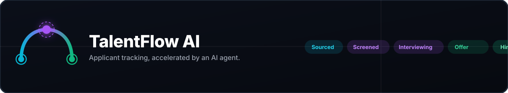
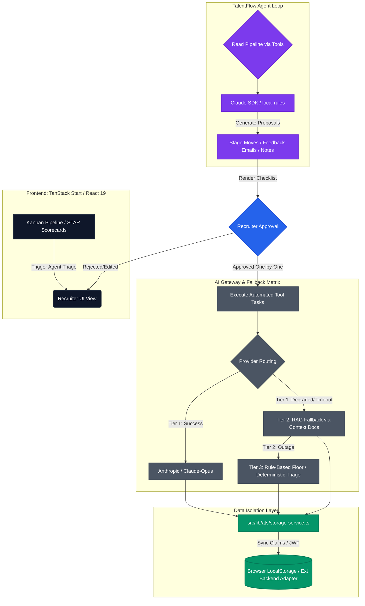

# TalentFlow-AI

<div align="center">

<picture>
  <source media="(prefers-color-scheme: dark)"  srcset="assets/readme-banner.svg">
  <source media="(prefers-color-scheme: light)" srcset="assets/readme-banner-light.svg">
  
</picture>

<br/>

[](https://talentflow-ai.vercel.app)
[](https://github.com/JawadulHadi/talentflow-ai/releases)
[](LICENSE)
[](https://tanstack.com/start)
[](https://www.anthropic.com)

</div>

**TalentFlow AI** is a lightweight applicant tracking system (ATS) with an AI recruiting agent, structured STAR scorecards and hiring analytics. It gives a small recruiting team the pipeline visibility of an enterprise ATS without the enterprise ATS.

> **Live demo:** <https://talentflow-ai.vercel.app> — demo data lives in your browser (`localStorage`); use the reset button in the header to restore it.


## System Architecture

TalentFlow is a single TanStack Start app. The UI and all ATS data live in the browser. The server renders the app shell and hosts the server functions that call Claude.



### The Agent Loop & Guardrails

The agent reads a snapshot and **never writes**. A human approves every proposal. It runs up to 8 steps using the following tools:

| Tool | Kind | Purpose |
| :--- | :--- | :--- |
| `get_pipeline_overview` | read | KPIs, funnel, bottleneck, open applications per job and stage |
| `list_candidates` | read | Compact rows filtered by job, stage and days in stage |
| `get_candidate` | read | Full record: history, skills, strengths, gaps, recent feedback |
| `propose_stage_move` | proposal | Move to another stage (standard stage emails follow on approval) |
| `propose_email` | proposal | Reminder or feedback email |
| `propose_note` | proposal | Internal note, also used to flag concerns |

- **Validation:** Proposals are validated (candidate exists, active, known stage/template, max 1 of each kind per candidate, max 15 total).
- **Strictness:** Tool schemas use `strict: true`. Requests use effort `medium` and `fallbacks: "default"`.
- **No Client Leaks:** The SDK and API key load only inside server functions; the browser bundle contains neither.

---

## Features

- **Jobs** — Requisitions with Draft → Active → Closed lifecycle and live applicant counts per job.
- **Pipeline** — Per-job Kanban across Sourced, Screened, Interviewing, Offer Sent and Hired. Stage moves are timestamped and send the matching candidate email.
- **Candidates** — Add manually with résumé attachment, duplicate detection per job, rejection with reason (and rejection email), reactivation, and permanent deletion for data-erasure requests.
- **TalentFlow Agent** — Reads the pipeline through tools and returns proposals that a recruiter approves one by one. Runs on Claude when `ANTHROPIC_API_KEY` is set, falls back to local deterministic triage rules otherwise.
- **Scorecards** — 10 weighted STAR questions with a deterministic score and verdict; Claude writes the narrative summary when connected.
- **Analytics** — Time to fill, stage velocity, funnel with bottleneck audit, source ROI, and diversity reporting based only on voluntary self-identification.
- **Team & Integrations** — Role hierarchy with pending invites; simulated job-board and HRIS connections.
- **Themes** — Frosted Slate, Frosted Ember, Paper Light and Signal Emerald.

---

## Directory Map

```text
src/
  routes/                 one file per page: index (analytics), pipeline, agent, jobs, team,
                          integrations, scorecard, deliverables; __root is the HTML shell
  components/             app shell, Kanban board, candidate drawer, add-candidate dialog, ui/ (shadcn)
  stores/
    ats-store.ts          candidates, jobs, team, integrations, ratings, JD; actions and migration
    ui-store.ts           theme and the offline-banner flag
  lib/ats/
    types.ts              domain types and enums (stages, sources, statuses, reasons)
    seed.ts               demo data and the shared sourcing-cost table
    storage-service.ts    persistence adapter (localStorage with an in-memory fallback)
    analytics.ts          funnel, velocity, KPIs, source ROI, diversity, formatters
    scoring.ts            deterministic weighted STAR scoring and verdicts
    agent.ts              agent snapshot, tool executors, proposals, local fallback (isomorphic)
    agent.server.ts       Claude loop and scorecard summary (server only)
    agent.functions.ts    TanStack server functions that wrap agent.server.ts
    ai-service.ts         client entry point: Claude first, local fallback second
    pdf.ts                jsPDF exports
```

---

## Persistence & Migrations

The store persists under the key `qeloma-ats-v1` with a `version` number. When the persisted shape changes, we bump `version` and extend `migrateAtsState`. Version 1 links candidates to jobs, adds jobs, team and integrations, and converts sync times to ISO timestamps. Renaming the key would silently discard every user's data, so the key never changes.

To move to a real backend, replace `storage-service.ts` with a remote adapter. The UI doesn't change.

---

## Quick Start

Prerequisites: **Node.js 22.12+** and npm.

```sh
git clone https://github.com/JawadulHadi/talentflow-ai.git
cd talent-flow-ai
npm install
npm run dev      # http://localhost:3000
npm test         # unit tests
```

To enable Claude locally, create `.env` from `.env.example` and set `ANTHROPIC_API_KEY`.

---

## Deployment (Vercel)

On Vercel, Nitro detects the platform and writes `.vercel/output`: static assets plus one Node function for SSR and server functions. `vercel.json` pins `npm ci` and `npm run build`.

```sh
npx vercel deploy --prod
```

**⚠️ Security Warning:** The deployment has no user authentication. Anyone with the URL can trigger agent runs. Before setting `ANTHROPIC_API_KEY` on a public URL, add auth or Vercel Deployment Protection and set a spend limit on the key.

---

## Documentation

| Document | What it covers |
| --- | --- |
| [docs/ARCHITECTURE.md](docs/ARCHITECTURE.md) | Data flow, persistence and migrations, the agent loop, deployment |
| [CHANGELOG.md](CHANGELOG.md) | Release history |
| [CONTRIBUTING.md](CONTRIBUTING.md) | Setup, required checks, project rules, release process |
| [SECURITY.md](SECURITY.md) | Reporting vulnerabilities and deployment responsibilities |
| [CODE_OF_CONDUCT.md](CODE_OF_CONDUCT.md) | Community standards |
| [AGENTS.md](AGENTS.md) | Architecture rules for AI coding agents |

---

## Built With

- **Framework:** TanStack Start (React 19, SSR) with file-based TanStack Router
- **State:** Zustand with `persist`, stored in `localStorage` through a swappable adapter
- **Styling:** Tailwind CSS v4 with `data-theme` token sets and a `glass` utility
- **AI:** Anthropic SDK (`claude-opus-5-5`), server-side only
- **Build & Hosting:** Vite + Nitro, emitting the Vercel Build Output API

---

## License

[MIT](LICENSE) © 2026 Jawad Ul Hadi

<div align="center">

**Let's build something resilient together.**

[](https://juhbukhari.vercel.app)
[](https://juhbukhari.vercel.app/resume.pdf)
[](https://juhbukhari.vercel.app/case-study)
[](https://linkedin.com/in/jawad-ul-hadi)
[](https://gitlab.com/JawadulHadi)
[](https://stackoverflow.com/users/19086162/jawad-ul-hadi)
[](https://orcid.org/0009-0007-1317-4615)
[](https://calendly.com/jawadulhadicc)
[](mailto:jawadulhadicc@gmail.com?subject=Hello%20Jawad&body=Hi%20Jawad%2C%0A%0AI%20came%20across%20your%20profile.)

</div>
```
